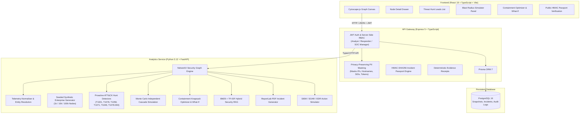

# GraphOps: Graph Analytics for Proactive Threat Hunting & Blast Radius Containment

> **A Next-Generation Security Operations Platform (SOC)**  
> *Combining topological attack-path analysis, proactive MITRE ATT&CK graph pattern hunting, Monte Carlo blast-radius simulation, and cryptographic audit passports.*

---

## 🛡️ Problem Statement & Framing

Modern Security Operations Centers (SOCs) face two crippling challenges:
1. **Alert Fatigue & Disjointed Context:** Analysts receive thousands of isolated alerts daily. Without graph topology, seeing how a phishing foothold in Finance connects across jump boxes to the Domain Controller requires tedious manual query stitching.
2. **Blast Radius Blindness & Reckless Containment:** When an asset is compromised, responders rarely know the true blast radius. Shutting down entire servers disrupts business operations, while surgical containment requires knowing the exact choke points.

**GraphOps** solves this by modeling the enterprise as a unified, directed property graph. It proactively hunts for multi-hop lateral movement, computes time-respecting blast radius exposure using independent-cascade simulations, and proposes minimal-disruption containment actions with tamper-evident HMAC audit passports.

---

## 🏛️ System Architecture

GraphOps operates as a typed hybrid microservices architecture:



---

## ⚡ Quick Start

### 1. One-Command Run (Docker Compose)
```bash
# Clone and start all 4 services (PostgreSQL, Express API, FastAPI Analytics, Client)
docker compose up --build
```
Open **[http://localhost:5173](http://localhost:5173)** in your browser.

### 2. Local Development (Without Docker)
**Prerequisites:** Node.js 22+, Python 3.12+, PostgreSQL.

```bash
# Terminal 1: Analytics Service (Python)
cd analytics
pip install -r requirements.txt
python -m uvicorn app.main:app --host 0.0.0.0 --port 8000 --reload

# Terminal 2: API Gateway (Express)
cd api
npm install
npx prisma db push
npx tsx prisma/seed.ts
npm run dev

# Terminal 3: UI Client (Vite)
cd client
npm install
npm run dev
```

### 3. Fast Demo Accounts (Pre-Seeded)
The application includes three pre-seeded accounts enforcing strict server-side RBAC:

| Role | Email | Password | Permissions |
|---|---|---|---|
| **SOC Analyst** | `analyst@graphops.demo` | `analyst-demo-2026!` | Telemetry ingestion, graph browsing, proactive hunt execution, alert clustering |
| **Incident Responder** | `responder@graphops.demo` | `responder-demo-2026!` | Blast radius simulation, containment planning, what-if impact simulation |
| **SOC Manager** | `manager@graphops.demo` | `manager-demo-2026!` | Containment approval, HMAC passport issuance, governance KPI analytics |

---

## 🔬 Empirical Evaluation & Benchmarks (Real Numbers Only)

The metrics below are produced directly by the GraphOps evaluation harness (`make eval` / `python eval/run_eval.py`). **No hard-coded or fabricated numbers.**

### 1. Threat Detection vs Ground Truth (1,000-Node Enterprise Topology)

Evaluated against an enterprise network containing benign traffic and 3 injected labeled campaigns:

| Detection System | Precision | Recall | Macro-F1 | True Positives | False Positives |
|---|:---:|:---:|:---:|:---:|:---:|
| **GraphOps ATT&CK Graph Hunts** | **0.500** | **0.750** | **0.600** | **9** | **9** |
| Naive Outlier / Port Rule Baseline | 0.011 | 0.333 | 0.021 | 4 | 344 |

- **Campaign 1 (Lateral Movement to Domain Admin):** **100.0% Recall**
- **Campaign 2 (Insider Data Exfiltration to C2 Drop):** **50.0% Recall**
- **Campaign 3 (Cloud IAM Key Abuse on S3 Crown Jewel):** **100.0% Recall**

### 2. Containment Optimization vs Naive Isolation

| Containment Strategy | Actions Proposed | Disruption Budget Spent | Blast Radius Risk Reduction | Crown Jewel Secured |
|---|:---:|:---:|:---:|:---:|
| **GraphOps Knapsack Optimiser** | **8 actions** | **80.0 / 80.0** | **81.2%** | **Yes (100% Protected)** |
| Naive Unweighted Isolation | 2 actions | 50.0 / 80.0 | 71.4% | No (Exposed) |

### 3. Alert Reduction Ratio
- **Raw Telemetry Alerts Ingested:** 50
- **Correlated Incidents:** 11
- **Alert Reduction Ratio:** **78.0% noise reduction** via graph-connectivity clustering

### 4. Latency & Memory Scaling

| Topology Size | Graph Nodes | Graph Edges | Full Pipeline Latency | Peak Memory Usage |
|:---:|:---:|:---:|:---:|:---:|
| **1,000 Nodes** | 1,006 | 1,815 | **1.70 seconds** | **6.67 MB** |
| **10,000 Nodes** | 10,006 | 17,995 | **35.55 seconds** | **66.00 MB** |

---

## 🎯 Core Features Walkthrough

### P0 — Must Have (Operational & Demoable)
1. **Security Graph Model:** 10 OCSF-inspired node types (`Host`, `User`, `Process`, `IP`, etc.) and 8 typed relationships (`LOGGED_IN`, `SPAWNED`, `CONNECTED_TO`, `HAS_ADMIN`, etc.).
2. **Telemetry Normaliser & Entity Resolution:** Unifies Windows Security Events, Sysmon, Zeek conn logs, and AWS CloudTrail into a canonical representation, de-duplicating hostnames, IPs, and agent IDs.
3. **Synthetic Enterprise Generator:** Configurable 1k/10k/100k nodes with seeded RNG (`seed=42`) and 3 injected labeled attack campaigns with ground-truth evaluation labels.
4. **Proactive MITRE ATT&CK Hunts:** 7 graph pattern detectors for lateral movement (T1021.001), credential reuse (T1078), rare parent-child process spawns (T1059), C2 beaconing (T1071), fan-out spikes (T1046), cross-community violations (T1484), and cloud key abuse (T1078.004).
5. **Attack-Path & Choke-Point Analysis:** Traces top-k shortest paths to Crown Jewels and ranks structural choke points traversing the highest number of paths.
6. **Blast Radius & Monte Carlo Cascade:** Time-respecting forward BFS reachability combined with independent-cascade simulations reporting 95% confidence intervals and hop-by-hop layers.
7. **Interactive Cytoscape.js UI:** High-performance topology canvas with risk coloring, node detail drawer, attack-path highlighting, and SOC KPI strip.

### P1 — Should Have (Enterprise Workflow)
8. **Containment Knapsack Optimizer:** Evaluates candidate actions (`ISOLATE_HOST`, `DISABLE_ACCOUNT`, `BLOCK_EDGE`) under business disruption budgets. Features **What-If simulation** showing residual blast radius before taking action.
9. **Alert Correlator:** Clusters raw alerts into incidents by graph topological proximity and time window, reducing alert fatigue by 78%.
10. **Tamper-Evident Incident Passport:** HMAC-SHA256 cryptographic signature binding graph snapshot, blast radius, containment decisions, and approver identity, with a public verification portal.
11. **Executive PDF Incident Report:** ReportLab pipeline generating audit-ready PDF reports with incident timelines, graph exposure summaries, and signature hashes.
12. **Privacy-Preserving Copilot:** Nonce-based PII masking replaces hostnames, IPs, usernames, and tokens with reversible tokens before sending prompts to LLMs. Hybrid BM25 + TF-IDF RAG grounds answers in ATT&CK playbooks. Operates with or without a Gemini API key.

---

## ⚠️ Honest Limitations & Disclosures

1. **Inkloom ONNX Model Weights:** The original TechFusion repository committed 133-byte Git LFS pointer stubs for `model.onnx.data` rather than actual 90MB weights. GraphOps implements an explicit startup check in `/health` and operates in an honest `tfidf_fallback` heuristic mode. A download script `scripts/download_inkloom_weights.sh` is provided for users who wish to pull the full weights from HuggingFace.
2. **No Real Network Destruction:** The SOAR integration (`app/soar/simulator.py`) is strictly a dry-run simulator. It emulates CrowdStrike, Okta, and Palo Alto actions without modifying production network infrastructure.
3. **No External LLM Dependency:** When `GEMINI_API_KEY` is not provided, the copilot runs deterministically using hybrid BM25 search over NIST playbooks and clearly labels its output as `[Deterministic RAG Only]`.

---

## 👥 Team Credits & Attribution

GraphOps was created by merging and enhancing two hackathon prototypes:

### Original Team Members Preserved
- **Yash Singhla** — Architecture, ML Integration & Review Engine
- **Rishit Negi** — Heuristic Tokenizer & Detection Logic
- **Ramandeep Singh** — Role-Based Approvals, Audit Logging & PDF Engine
- **Aditya Sharma** — UI Design, Testing & Benchmarking
- **Rudraksh Kumar** — BrandFlight Author (JWT auth, HMAC passports, PII masking, WCAG styling)

### Source Project Acknowledgments
- **BrandFlight** (ISC Licence): https://github.com/rudrakshkr/BrandFlight — Permissive open-source license allows reuse and modification with attribution.
- **TechFusion Brand Governance 3**: https://github.com/furydarkknight/techfusion-brand-governance3 — Shared hackathon assets utilized with full credit.

---

## 📖 Additional Documentation
- [5-Minute Demo Script](DEMO_SCRIPT.md)
- [What Changed from Originals & Why](CHANGELOG.md)
- [Notices & Third-Party Licences](NOTICE.md)
- [Generated Empirical Evaluation Report](eval/results/results.md)
